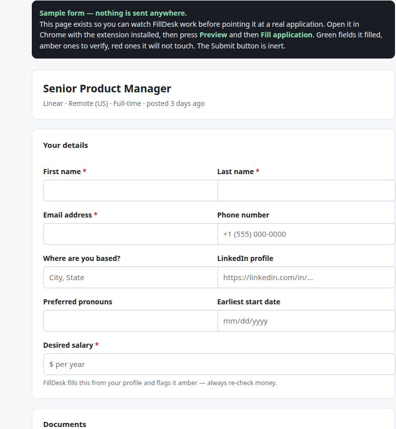

# QUICKSTART — from zero to a filled application in about 6 minutes

Do this once, then use the daily loop at the bottom.

---

## 1. Start the local server

```bash
cd ~/projects/Job-Application-Filler     # or wherever you unpacked it
./run.sh --open
```

You should see:

```
  FillDesk 0.1.0  --  dashboard http://127.0.0.1:8756
  extension token: <something>
  llm: none (no key: rule-based packets)
```

Leave this terminal open. No Python packages to install — it is standard library only.

## 2. (Optional, recommended) Add a model

Without a key the tool still works: packets are built from your own saved answers
plus keyword re-ranking, and unknown questions become flagged skeletons instead of
invented prose. With a key you get real drafting.

Either do it in the dashboard (**Settings → Writing model → Test model → Save settings**),
or start with environment variables:

```bash
FILLDESK_LLM_PROVIDER=openai   FILLDESK_LLM_MODEL=gpt-4o-mini               FILLDESK_LLM_API_KEY=***  ./run.sh
FILLDESK_LLM_PROVIDER=anthropic                                           FILLDESK_LLM_API_KEY=***  ./run.sh
FILLDESK_LLM_PROVIDER=ollama   FILLDESK_LLM_MODEL=llama3.1                ./run.sh   # local, free
FILLDESK_LLM_PROVIDER=openai   FILLDESK_LLM_BASE_URL=https://openrouter.ai/api/v1  FILLDESK_LLM_MODEL=…  FILLDESK_LLM_API_KEY=***  ./run.sh
```

You bring your own model: FillDesk bundles no inference and resells none. If this
machine already has an OpenAI-compatible endpoint configured, a shortcut exists:

```bash
python3 tools/use_pi_model.py --list      # what pi has configured
python3 tools/use_pi_model.py             # adopt pi's default provider + model
python3 tools/use_pi_model.py --revert    # back to rule-based, no key
```

It copies the base URL, model and key into `data/settings.json` (mode 0600, never
committed) and nothing else. Reasoning models that think out loud can run out of
output tokens mid-packet — the **Don't let reasoning models think out loud** box in
Settings avoids that, and FillDesk retries with a bigger budget automatically.

## 3. Load your real resume (this is the 20 minutes that saves 200 hours)

Fastest way: let the dry run read it and draft a profile, then correct it in the
dashboard.

```bash
python3 tools/dry_run.py --resume ~/resumes/me.pdf
```

It prints how much it understood and writes `reports/dry-run-<stamp>.md`: the fields
it read, the roles and dates it guessed, the packet it built, and every field on a
sample application form marked *fill / attach / verify / leave alone / refuse*. It
backs up your current profile first and prints the command to undo everything. Read
that report before trusting any of it — that is the point of it.

Then in the dashboard → **Profile**:

1. Identity: name, email, phone, city, LinkedIn.
2. **Master resume** — paste your real resume text (or upload a PDF/DOCX and read
   what came out; PDF extraction is best-effort, pasting is reliable).
3. **Your reusable answers** — write real answers to the five questions every
   application asks: *Why this company? / A challenge or conflict / Why are you
   leaving? / A project you shipped end to end / Your greatest weakness.*
   Packets reuse these instead of generating filler, and this is the single
   highest-leverage thing in the whole tool.

Shortcut to look at a populated example first:

```bash
python3 tools/seed_demo.py      # demo profile + two saved jobs
```

## 4. Install the Chrome extension

1. Open `chrome://extensions`
2. Toggle **Developer mode** (top right)
3. **Load unpacked** → select the `extension/` folder of this project
4. Click the FillDesk icon → paste the **token** printed in step 1 → **Save connection**
5. Pin the icon

## 4b. Two buttons worth knowing

- **`Cover letter`** — writes a letter for the posting on screen (needs the job saved
  first). It appears as a draft with Copy and "Review in dashboard". A draft is not an
  answer: nothing is typed or uploaded until you build a packet, read it, approve it.
- **`Ask per field`** — the careful mode. It stops at each field and waits: `Y` fills,
  `N` leaves it to you, `A` fills the rest, `Esc` stops. After a run, **Undo what
  FillDesk typed** clears what it wrote.

Date fields anywhere in the dashboard carry a **📅** button: month+year for a job,
bare year for schooling, a full day for "earliest start". The same picker appears in
the panel's per-field card whenever a form wants a date, and what you click gets
re-shaped into that field's format (`06/2021`, `2021-06`, `06/05/2024`). Choose *Year
only* when that is honestly all you know — a guessed January is worse than a year.

Useful before any of it: `python3 tools/import_skills.py skills.txt` and
`python3 tools/import_linkedin.py linkedin-export.zip --dry` (LinkedIn → Settings →
Data privacy → *Get a copy of your data* — the official export, because logging into
LinkedIn through a tool is how accounts get restricted).

## 5. Verify it on the sample form before trusting it



*This page is local (`/preview.html`), the data on it is fake, and its Submit button is
inert — it is the safe place to learn what the panel does before pointing it at a real
employer.*

Dashboard → Settings → *Open the sample application form* (or open
`http://127.0.0.1:8756/preview.html`). Press **Preview**, then **Fill application**.

Expected: green fields filled, amber fields marked *verify* (salary, start date,
relocation), and the compliance block — gender, veteran status, disability, work
authorization, date of birth, certification, signature — outlined red and untouched.

Or check it without a browser at all:

```bash
node tools/simulate.mjs
```

---

## The daily loop

1. On a job listing, click the extension → **Save this job** (or `Ctrl+Shift+S`).
2. Dashboard → **Jobs** → **Build packet** (~30s).
3. **Read it.** Fix anything in the resume box, the cover letter, and each answer.
   Anything you leave as `[NEEDS INPUT]` blocks approval unless you force it —
   and even then the extension will not type it.
4. **Approve packet.** This is the gate: the extension can only type what you approved.
5. Go to the actual application, click the extension → **Fill application**.
   Watch it go field by field.
6. **Read the whole page**, including collapsed sections. Answer the red fields
   yourself. Attach anything it could not attach.
7. **You press Submit.** FillDesk never does, and never will.
8. Dashboard → Jobs → mark it submitted when the employer confirms.

## Verifying everything that can be verified without a browser

```bash
./tests.sh
```

90 checks: the API, the packet builder, the compliance wall in **both** languages,
manifest integrity, resume ingestion, and the field matcher's refusal behaviour.
