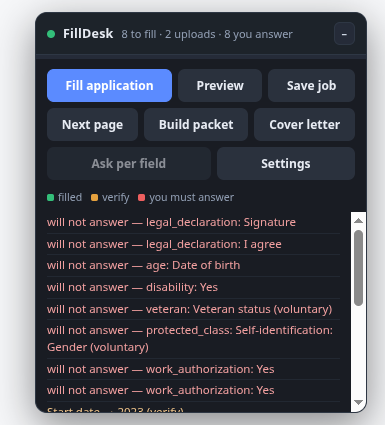
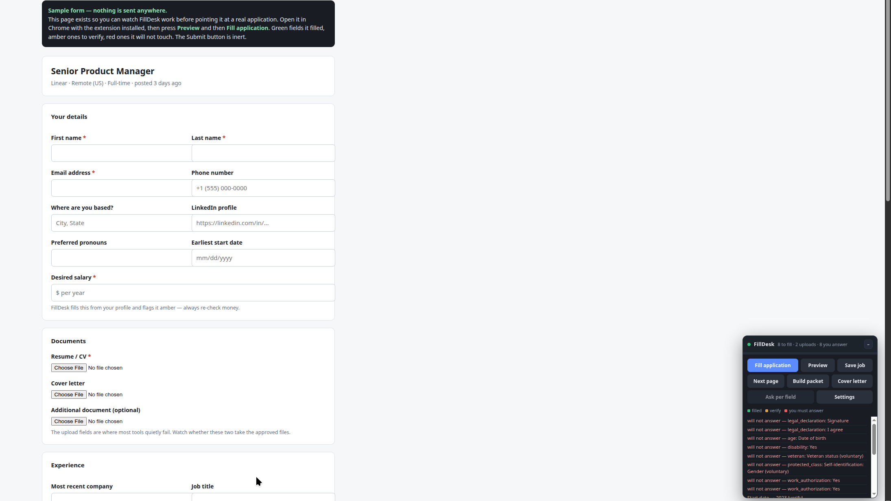

# FillDesk

A local job-application filler you can actually trust with your name.

You keep one accurate profile. For each job it drafts a **packet** — a tailored
resume, a cover letter, and answers to that employer's questions. You edit it and
approve it. Then a Chrome extension types *exactly what you approved* into the
application, field by field, in front of you, and stops. You read the page and
press Submit yourself.

It is deliberately not an auto-apply bot. Volume is the thing that makes AI
applications bad; the point here is fewer applications that are actually good,
with a human in the loop at the one step that matters.

```
┌──────────────┐   save job    ┌──────────────────┐   approved packet   ┌───────────────┐
│ Chrome tab    │ ────────────► │  local server     │ ◄───────────────── │  Chrome tab     │
│ job listing   │               │  127.0.0.1:8756   │   (typed into the  │  application    │
│ (you browsing)│ ◄──────────── │  dashboard + API  │ ───► form)         │  form           │
└──────────────┘   packet +     │  your data in ./  │   preview/fill     └───────────────┘
                  review        └──────────────────┘
                                     │  only outbound call:
                                     ▼
                             your chosen model provider
```



*The extension panel, mid-review, on the sample form that ships with the app. Green =
will fill, amber = verify, red = **you must answer, and this tool will not touch it**.
The persona is the invented demo one and nothing is sent anywhere.*

---

## What it refuses to do

These are hard-coded, tested from both sides (Python and JavaScript), and **not
user-configurable**:



*The panel's count line reads `8 to fill · 2 uploads · 8 you answer`. On a real portal
those eight red rows are the whole argument for review-first: they are the questions
where an autofiller destroys your application, or worse, your credibility.*

| Never | Why |
|---|---|
| Press **Submit** / Apply / Finish / Send | A wrong application sent at 3×/s is worse than none. There is no `.submit(` anywhere in the extension; a test asserts it. |
| Answer **race, ethnicity, gender, religion, sexual orientation** | Protected-class self-identification. An autofilled wrong answer is a legal problem, not a formatting problem. |
| Answer **disability / accommodation** | Same, plus it can follow you. |
| Answer **veteran / protected-veteran status** | Same. |
| Answer **work authorization, citizenship, visa sponsorship** | The single most damaging thing to get wrong, and the one auto-fillers get wrong. |
| Answer **age / date of birth**, **arrests or convictions**, **health, marital status** | Same category of harm. |
| Sign or attest anything ("I certify that…", signature fields) | You certify. Not a script. |
| Type anything you did not approve | Unapproved packets return HTTP 423 to the extension; answers containing `[NEEDS INPUT]` are never typed. |
| Touch passwords, card numbers, SSN / tax IDs | Those plus "search" boxes and captcha widgets are excluded outright. |
| Upload your data anywhere | The only outbound network call is the model call you configure. Everything else is loopback. |

Fields it *can* answer but always flags amber: salary, relocation/work model,
start date, notice period, clearances, references.

## What it does well

- **One profile, every application.** Identity, links, work history, education,
  skills, and your own reusable answers, entered once.
- **Real tailoring.** Keyword overlap re-ranks your bullets so the relevant
  evidence is on page one; the resume export is single-column, ATS-safe markdown →
  DOCX or print-to-PDF HTML.
- **Honest keyword coverage.** It tells you which words in the posting are absent
  from your resume, instead of inventing an "ATS score" — those scores are
  per-tenant and undocumented, and no vendor can really give you one.
- **Works with no API key.** Rule-based packets: template letter, your boilerplate
  answers matched by intent, skeletons where it would otherwise lie.
- **Watchable autofill.** Fields highlight green (filled), amber (verify), red
  (you must answer). Multi-page forms get `Next page` — never `Submit`.
- **Iframe-aware.** Fills every frame of the tab, because plenty of ATS forms are
  inside an iframe.
- **Review one field at a time.** Switch on `Ask per field` in the panel and it stops
  at every field: `Y` fills, `N` leaves it to you, `A` fills the rest, `Esc` stops. The
  summary then lists what it did, with **Undo what FillDesk typed** to put the form back.
- **A cover letter for the page you are on.** `Cover letter` drafts one from that
  posting in the panel, or from the Jobs tab. It lands as a draft on the job record —
  never in the autofill path — and the packet still has to be read and approved.
- **Compliance claims are stripped out of drafts.** During testing a model read a home
  town and a language and wrote "I am authorized to work in the United States without
  sponsorship". Every drafted field — resume, letter, answers — is now scanned
  sentence by sentence, any such statement is replaced with `[NEEDS INPUT]`, and the
  dashboard shows you exactly what was removed and why. Those statements are yours.
- **Imports, not re-typing.** `tools/import_skills.py` for a skills list, and
  `tools/import_linkedin.py` for your own **LinkedIn data export** (Skills, positions,
  education, About). FillDesk never logs into LinkedIn, or anything else, for you.
- **Dates you pick, not type.** Profile start/end years and schooling get a small
  calendar; so does each date field in the ask-per-field review card. It picks
  month+year, or a bare year, or a full date — the shape the field asked for — and it
  will never invent a day for a job you remember as `2021-06`.
- **Coverage you can measure.** Every run logs fields filled / unrecognised /
  refused per host into `data/events.jsonl`, and the dashboard shows it. If a site
  keeps producing unrecognised fields, that is the real coverage answer.
- **Local-first.** Your résumé, address, history and token live in `./data`.
  Delete the folder and this tool has nothing.

---

### Rewrite what you wrote, without adding to it

Every answer field has **Polish with AI**: you write the honest clumsy sentence, the
model restates it professionally. It is a style-only operation and the rewrite is
diffed against everything you have already put in writing, so a rewrite that
introduces a figure, an employer, a tool or a legal-status claim is **refused** and
your words are kept — with the refused version shown, so you can take the wording and
fix the invented part yourself.

A rewrite always lands as *unverified*, which means the extension cannot type it until
you read it and tick the box again. On the profile tab, the rewrite is only placed in
the box: saving stays your decision.

## Install

Requirements: Python 3.10+ and Chrome (or any Chromium browser). No pip packages,
no build step. Node is optional, only for `node --test` and `tools/simulate.mjs`.

1. `./run.sh --open` → dashboard on <http://127.0.0.1:8756>
2. `chrome://extensions` → **Developer mode** → **Load unpacked** → pick `extension/`
3. Extension popup → paste the token printed by the server → **Save connection**
4. Full walkthrough: **[QUICKSTART.md](QUICKSTART.md)**

## Try it on your own resume first

Before the extension touches anything, see what this tool makes of your real
resume and exactly what it would type, refuse and leave alone:

```bash
python3 tools/dry_run.py --resume ~/resumes/me.pdf
python3 tools/dry_run.py --resume me.docx --posting a_real_posting.txt --company Acme --title "Systems Engineer"
```

It reads the file, drafts profile fields from it (contact details, links, roles,
dates, bullets), builds a packet, runs the **real** field matcher over a sample
application form, and writes `reports/dry-run-<stamp>.md` with every decision
itemised: filled / attached / flagged-for-you / left-alone / refused, and what it
**could not** work out. Your existing profile is backed up first and the report
prints the restore command. No job site is contacted; with no model key nothing
leaves the machine at all.

PDF reading uses `pdftotext` when poppler is installed and falls back to a
built-in reader. Either way, if a PDF has no usable text layer (a scan, or
subsetted CID fonts) it says so instead of pasting garbage into your profile.

## Daily loop

```
browse a listing → Save this job → Build packet → read + edit → Approve
     → open the real application → Fill application → read the page
     → answer the red fields yourself → you press Submit
```

Keys: `Ctrl+Shift+F` fill, `Ctrl+Shift+S` save job (both changeable at
`chrome://extensions/shortcuts`).

## Layout

```
server/            stdlib-only backend
  app.py           HTTP server, routing, CORS + token gate, multipart uploads
  packet.py        packet builder: LLM path + rule-based path, question extraction
  sensitive.py     the compliance wall (mirrored in extension/matcher.js)
  llm.py           openai-compatible / anthropic / gemini / ollama / none
  store.py         profile, jobs, packets, event stats in ./data
  resume_parse.py  DOCX + best-effort PDF text extraction
  resume_export.py markdown → ATS DOCX, print-to-PDF HTML, keyword coverage
web/               dashboard (vanilla JS): profile, jobs, packet review, settings
  preview.html     a sample application form to test the extension against
extension/         Chrome MV3
  matcher.js       pure field-classifier — unit tested in Node, no DOM
  content.js       form scanning, value injection, uploads, panel UI
  background.js    token-carrying proxy to localhost + all-frames broadcast
  popup.html/js    connection, packet picker, page actions
tools/
  seed_demo.py     demo profile + two jobs
  dry_run.py       your resume in, a review report out — no browser, no job site
  use_pi_model.py  developer shortcut: adopt a locally configured endpoint
  simulate.mjs     browser-free dry run of the matcher on preview.html
  make_icons.py    generates the extension icons
tests/             90 checks: API, rules, resume ingestion, compliance parity, matcher behaviour
data/              your data (gitignored): profile.json, jobs/, packets/, api_token
```

## How the matching works

`content.js` builds a descriptor per control: label (via `label[for]`, `aria-label`,
`aria-labelledby`, wrapping label, preceding sibling, container text), section
heading, name/id/placeholder/`autocomplete`, options, radio group context, date
hint. Compliance is decided **first**, on the whole signal, so a loose rule can
never claim an EEO field. Then:

1. A **sentence** on the form is treated as an employer question and matched against
   your approved answers (exact text, then intent, then token overlap ≥ 0.6).
2. Otherwise **structural rules** map it to your profile (identity, address, links,
   documents, employment history, education, review-flagged fields).
3. Otherwise it is **left alone with a reason** — visible in the panel and in
   `data/events.jsonl`.

Two rules exist purely to stop confident nonsense:

- employment start/end dates need *employment context* (a section heading or
  employer/title neighbours), so "Earliest start date" cannot be filled with your
  first job's start date;
- nothing is typed for a question whose approved answer still contains
  `[NEEDS INPUT]`.

Writing into the page uses the framework-safe path: native setter where available,
React `_valueTracker` reset, then `input` + `change` + `blur`, because React and
Angular otherwise silently discard a direct `.value =` assignment. Selects match an
option by normalised text and refuse to guess between "3-5 years" and "5+ years".
File inputs are filled by fetching the approved document through the service
worker and assigning a `DataTransfer` (works on most, not all, uploaders).

## Storage & API

Everything is JSON in `./data`. Loopback-only by default; the extension must send
`x-filldesk-token` (copied from Settings) so a random web page cannot read your
profile off `127.0.0.1:8756`.

Main endpoints: `GET/PUT /api/profile`, `POST /api/profile/resume`, `GET|POST
/api/jobs`, `POST /api/jobs/capture`, `POST /api/packets`,
`PUT /api/packets/<id>`, `POST /api/packets/<id>/approve`,
`GET /api/packets/<id>/file?fmt=docx|html|txt`, `GET /api/packets/<id>/ats`,
`GET /api/autofill/snapshot` (423 until approved), `POST /api/events`,
`GET/PUT /api/settings`, `GET /api/status`.

## Verify

```bash
./tests.sh                 # 90 checks, no browser needed
node tools/simulate.mjs    # what would be filled, uploaded, refused on preview.html
python3 tools/dry_run.py --resume your_resume.pdf   # the whole pipeline, on your real resume
```

## Honest limitations

Read this before trusting it with your job search.

- **It is only as good as your profile.** Garbage in, confidently worded garbage out.
- **ATS coverage is uneven and I cannot promise otherwise.** Greenhouse, Lever,
  Workable, Ashby and plain HTML forms are the easy cases; Workday, SuccessFactors,
  Taleo and iCIMS fight you with shadow DOM, iframes and lazy sections. Use
  **Preview** on a real form first — it shows exactly what would be filled before
  anything is typed. The panel's "unrecognised" count is the honest number.
- **File upload injection works on most uploaders, not all.** Some re-validate
  through their own XHR and will reject a synthetic file. It tells you when it fails.
- **PDF resume extraction is best-effort.** With poppler's `pdftotext` installed it
  handles most real resumes; without it, complex layouts lose their column order.
  No text layer (a scan) means pasting the text instead. Either way the tool refuses
  to ingest text it cannot read as language, and `tools/dry_run.py` shows you
  everything it got wrong **before** you rely on it.
- **Model output still needs your eyes.** The prompt forbids inventing employers,
  dates, metrics and credentials, and gaps come back as `[NEEDS INPUT]`, but a model
  can still word something you would not. Approval is yours.
- **Job boards' terms of service.** This reads the page you already have open and
  saves it to your own machine — like a clipper. It does not crawl, does not
  automate LinkedIn's Easy Apply, and does not log in as you. Automated bulk apply
  violates most boards' terms and gets accounts flagged; that is also why this tool
  has no "apply to 200 jobs" button.
- **Detection.** A well-tailored, human-reviewed application typed at human speed and
  submitted by you is not the thing ATSs flag; bot-speed bulk submission is. Nobody
  can promise how a specific ATS will treat AI-assisted text — including the vendors
  that claim to.
- **No accounts, no sync, no mobile app.** One machine. `data/` is the whole state,
  so `tar czf` it and copy it over.
- **Unpacked extension only, for now.** Loading `extension/` takes two minutes and
  needs Developer mode, which is fine for a technical user and a wall for everyone
  else. A store-listed build is a packaging decision, not a code change.

## Troubleshooting

| Symptom | Fix |
|---|---|
| Popup says *cannot reach http://127.0.0.1:8756* | `./run.sh` is not running, or the port differs. Set the server URL in the popup. |
| Extension says *missing or wrong X-FillDesk-Token* | Dashboard → Settings → copy token → paste into the popup → Save connection. |
| Nothing happens on the page | Reload the tab after installing the extension. Content scripts do not attach to tabs opened before installation. |
| Panel does not appear | It only mounts on pages that look like applications/ATS hosts. Use the popup's **Fill application** — it works anywhere. |
| Fields go in and then vanish | A framework re-render. Check the browser console; report the host and the field label — this is the classic autofill failure. |
| Upload refuses the file | Attach it by hand. The panel logs why. |
| Packet says *no employer questions found* | They were not in the saved text. On the live form, press **Save job** again (it re-scans the visible form), or paste the questions into the job's description. |
| A compliance field looks filled | It never is. Press Preview; red outline = untouched and yours. |

## Making it better

The durable moat in this category is not the model, it is field-mapping coverage
with tests. Highest-value next steps:

1. A per-ATS fixture suite: save the DOM of each form you actually hit into
   `tests/fixtures/`, extend the matcher tests, and watch the unrecognised count fall.
2. Per-host adapters for the hostile ones (Workday shadow DOM, SuccessFactors
   iframes) rather than more generic heuristics.
3. Interview prep from the same packet, since the material is already there.
4. Follow-up drafting (thank-yous, recruiter replies) from `data/jobs` status.

## Your data

Your data stays in `./data` on this machine. The token in `data/api_token` guards
that API; treat it like a password and never enable `FILLDESK_OPEN_API` on a shared
machine. Notes, research and drafts you keep beside the code are yours: nothing is
uploaded, and `tests/test_no_personal_data.py` scans git history for strings from
your local profile so personal data cannot ride along when you publish.

The one place your text leaves the machine is the model endpoint **you** configure —
your provider's privacy terms apply there, and no key works without you typing it.

## License and terms

FillDesk is **proprietary**, not open source: `LICENSE.md` grants one person a
perpetual license to use it, and `TERMS.md` covers the sale — one-time price,
**non-refundable**, a 30-day limited warranty on top of an otherwise "as is" tool,
support through public GitHub Issues, and this sentence, which is the whole product
in one line:

> **You are responsible for every answer, document, and application submission made
> using FillDesk, and you should review each one before you press Submit.**

Both files are plain language and short. The bracketed lines in `TERMS.md` (legal
name, issue tracker URL, governing law, contact) need filling in before a sale.
